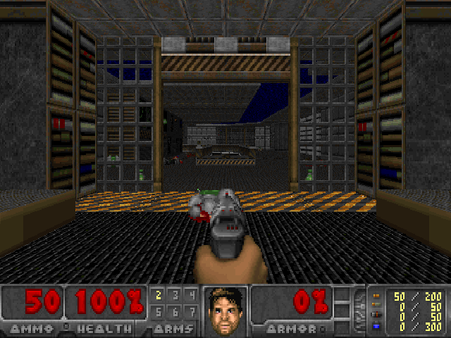
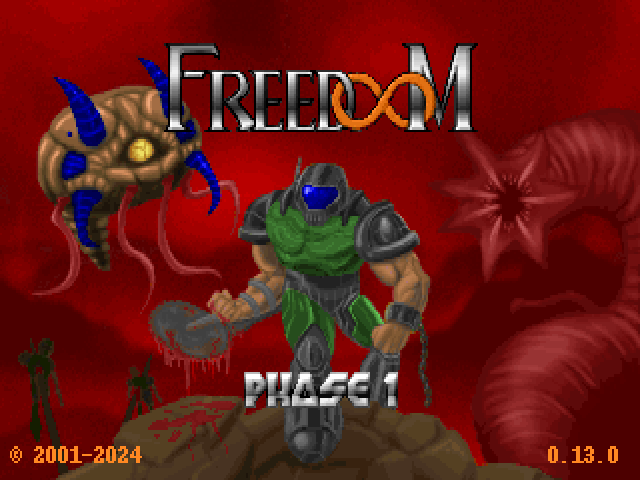
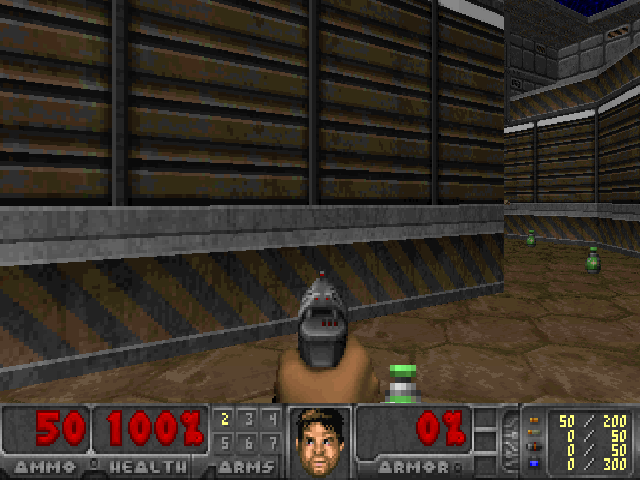
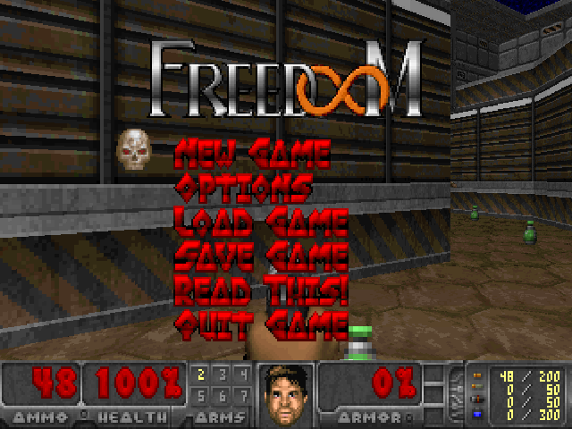

<p align="center">
  
</p>

<h1 align="center">RevitDoom</h1>

<p align="center">
  <b>Play the real DOOM inside Autodesk Revit.</b><br>
  A pyRevit extension · Revit 2025+ · .NET 8 · GPL-2.0
</p>

<p align="center">
  <a href="https://barkx.github.io/RevitDoom/">Project page</a> ·
  <a href="INSTALL.md">Install guide</a> ·
  <a href="src/BUILD.md">Build from source</a> ·
  <a href="CHANGELOG.md">Changelog</a>
</p>

<p align="center">
  
</p>

---

## What it does

RevitDoom adds a **DoomRevit** tab to the Revit ribbon with a **DOOM** button. Click it and the full DOOM game runs in a window inside Revit, with sound effects. It uses Managed Doom, a C# port of the original engine. Freedoom is included, and you can use your own `DOOM.WAD`. Your model isn't touched: the game runs in its own window.

- Runs the real DOOM engine at the original 35 updates per second, drawn at 640×400 and shown at 4:3.
- Pure managed code: if the engine fails you get a message in the console. Revit can't crash or hang because of the game.
- Sound effects in positional stereo (no music).
- Savegames and settings go to `%APPDATA%\RevitDoom\`.
- Cheats work (`iddqd`, `idkfa`, …).

### Screenshots

Real frames rendered by RevitDoom's engine with the bundled Freedoom:

| | |
|---|---|
|  |  |
|  |  |

## Requirements

- Autodesk Revit **2025 or newer** (.NET 8)
- [pyRevit](https://github.com/pyRevitLabs/pyRevit) (IronPython 2.7 or 3.4 engine)
- Windows 10 or 11

## Quick install

1. Download or clone this repository, for example to `C:\RevitExtensions\RevitDoom`.
2. In Revit: **pyRevit ▸ Settings ▸ Custom Extension Directories**, add the repository folder (the one that contains `RevitDoom.extension`).
3. Click **Save Settings and Reload**. A **DoomRevit** tab appears with a **DOOM** button.

Full instructions, updating, uninstalling and troubleshooting: **[INSTALL.md](INSTALL.md)**.

## Controls

| Action | Keys |
|---|---|
| Move | W/S or ↑/↓ |
| Strafe | A/D, or Alt + turn |
| Turn | ←/→ or mouse (click the game first) |
| Fire | Ctrl or left mouse button |
| Use / open | Space or right mouse button |
| Walk | Shift (always-run is on) |
| Weapons | 1–7 |
| Automap | Tab |
| Menu / release mouse | Esc |
| Console | F12 or ` |

## WADs

- **Freedoom: Phase 1** (BSD licence) is included in `RevitDoom.extension/wads/`.
- To play the original game, put `DOOM.WAD`, `DOOM2.WAD` or `DOOM1.WAD` into `RevitDoom.extension\wads\` or `%APPDATA%\RevitDoom\`. Original WADs are used first.
- **Shift+Click** the DOOM button to pick any WAD file.

## Repository layout

```
RevitDoom/
├── RevitDoom.extension/        the pyRevit extension (this is what Revit loads)
│   ├── DoomRevit.tab/          ribbon tab ▸ Games panel ▸ DOOM button
│   ├── lib/                    revitdoom.py (game window, console, input, render loop)
│   ├── bin/                    RevitDoom.Managed.dll (prebuilt engine + host)
│   └── wads/                   freedoom1.wad
├── src/                        C# sources + BUILD.md
│   ├── host/                   Managed Doom front-end for Revit (video, input, sound)
│   └── third-party-licenses/
├── docs/                       project page (GitHub Pages) + screenshots
├── INSTALL.md
├── CHANGELOG.md
└── LICENSE                     GPL-2.0
```

## Logs and troubleshooting

The console opens on its own during start-up and on errors (F12 toggles it). Everything is also written to `%APPDATA%\RevitDoom\host.log` and `doom.log`. See [INSTALL.md › Troubleshooting](INSTALL.md#troubleshooting).

## Credits and licence

- **Managed Doom** by Nobuaki Tanaka: https://github.com/sinshu/managed-doom (GPL-2.0)
- **Freedoom**: https://freedoom.github.io (BSD licence)
- **RevitDoom** by Marcel Žnidarič

RevitDoom is released under the **GNU General Public License v2.0**, see [LICENSE](LICENSE). Licences of the bundled third-party components are in [`src/third-party-licenses`](src/third-party-licenses).

DOOM is a trademark of id Software. Revit is a trademark of Autodesk. This project is not affiliated with or endorsed by id Software or Autodesk.
